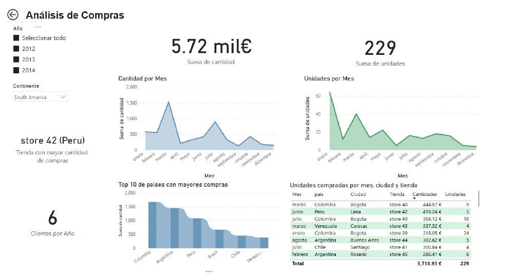

# Dashboard de ventas en Power BI

Práctica de Business Intelligence del Máster en Inteligencia Artificial (Universidad Europea de Madrid), asignatura Sistemas inteligentes. Trabajo realizado en equipo.

Análisis de un conjunto de ventas con Power BI: medidas en DAX para responder seis preguntas de negocio y un dashboard interactivo con segmentadores por año y continente.



## Datos

- **Archivo:** `Ventas.xls`, con 225 transacciones de venta.
- **Campos:** fecha, continente, país, ciudad, tienda, cliente, unidades y cantidad (importe en euros).
- Los datos se cargan en Power BI en una tabla llamada `all_sales`.

## Preguntas analizadas

| # | Pregunta | Resultado |
|---|---|---|
| 1 | Ventas en euros por continente y año | Mapa con la medida `Total Cantidad` y tabla de detalle |
| 2 | Diez ciudades con más ventas en 2014 y su total | Mapa con filtro Top N, medidas `Ventas 2014` y `Total 10 Ciudades 2014 Ventas` |
| 3 | Segundo país donde Marta compró más unidades | Alemania, con 76 unidades |
| 4 | Mes con más unidades vendidas en 2012 | Septiembre, con 116 unidades |
| 5 | Año y continente con mayores ingresos | Europa en 2013, con 5,298.47 |
| 6 | Cliente con más unidades compradas en un día en una tienda de París | Alberto, el 3 de agosto de 2012, tienda 11, con 12 unidades |

## Dashboard

- **Segmentadores:** año y continente.
- **Tarjetas:** ventas totales, unidades vendidas, tienda con mayores ventas y clientes por año.
- **Gráficos de áreas:** cantidad y unidades por mes.
- **Gráfico de cintas:** los diez países con mayores compras.
- **Tabla:** unidades y ventas por mes, ciudad y tienda.

## Ejemplo de medida en DAX

```dax
Ventas 2014 =
CALCULATE(
    SUM(all_sales[cantidad]),
    YEAR(all_sales[fecha]) = 2014
)
```

## Contenido del repositorio

| Archivo | Descripción |
|---|---|
| `acevesnavarrojorge_a4.pbix` | Informe de Power BI (se abre con Power BI Desktop) |
| `acevesnavarrojorge_a4.pdf` | Memoria con la explicación de cada pregunta y las medidas |
| `Ventas.xls` | Datos de ventas |
| `dashboard.png` | Captura del dashboard |

## Herramientas

Power BI Desktop, DAX, Excel.

## Autor

**Jorge Aceves Navarro** · Ingeniero en Computación · [GitHub](https://github.com/JorgeAN139)
